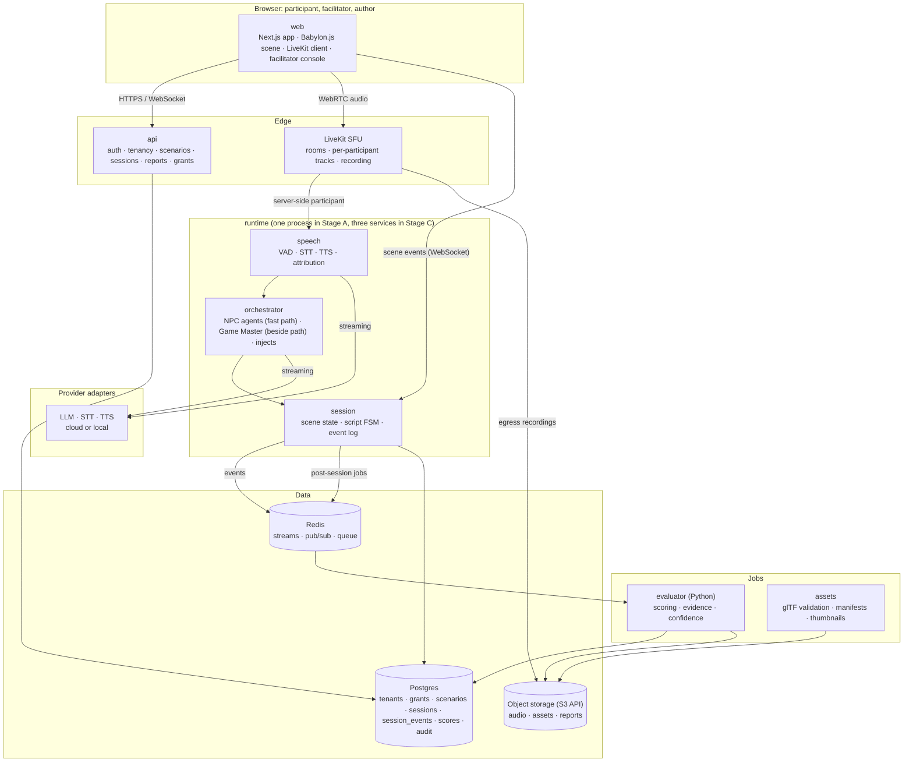

# AI Coaching RPG — Technical Architecture

Status: approved design, 1 October 2026
Companion to: *AI Coaching RPG — Product Specification* (sections referenced as "Spec §n")

## 1. Purpose and scope

This document describes the technical architecture for delivering the AI Coaching RPG: a multiplayer, script-driven role-play simulator in which a team plays scripted scenarios against AI-played counterparts inside a 3D scene, with every interaction recorded, transcribed and scored against rubrics.

It covers system structure, the real-time session path, AI orchestration, the 3D world and asset pipeline, the web application and its UI surfaces, data, security, deployment staging, observability and testing. It does not restate product requirements; where a design choice exists to satisfy a requirement, the Spec section is cited.

### Design goals, in priority order

1. **Runs on a laptop first.** The complete MVP starts with one command on a developer's or facilitator's machine, with participants joining over the LAN or a tunnel.
2. **Platform-agnostic.** The same codebase and container images deploy to Azure, AWS, GCP or any Kubernetes cluster by configuration, never by code changes.
3. **Prototype to enterprise without a rewrite.** Tenancy, audit, consent and retention are present in the schema and interfaces from day one, switched on by stage.
4. **Voice that feels conversational.** Time-to-first-audio for an NPC reply is a measured budget, not an aspiration.
5. **Script-first.** Everything the simulation does, including the 3D scene, is driven by the author-editable scenario script (Spec §6).

### Approach chosen

Containers plus ports-and-adapters. Every service is a container; cloud-specific capabilities sit behind six small adapter interfaces with one implementation per provider. Open-source infrastructure (Postgres, Redis, MinIO, LiveKit, OIDC) is the default and runs locally; managed equivalents are swapped in per cloud.

Alternatives considered and rejected: cloud-native serverless per cloud (three deployments to maintain; poor fit for the real-time session loop and asset processing), and a portability framework such as Dapr (fewer adapters to write, but another runtime to operate and abstractions that leak for streaming audio and large blobs).

## 2. System overview



### Services

| Service | Responsibility | Language | Stage A | Stage C |
| --- | --- | --- | --- | --- |
| `web` | Next.js app: authoring studio, lobby, 3D session view, facilitator console, reports | TypeScript | container | container |
| `api` | Auth, tenancy, role grants, scenario CRUD and validation, session lifecycle, reports, exports | TypeScript (Node) | container | container |
| `runtime` | Live session loop: scene state and script interpreter (`session`), VAD/STT/TTS and speaker attribution (`speech`), NPC agents and Game Master (`orchestrator`) | TypeScript (Node), LiveKit Agents | one container | three containers, same modules |
| `evaluator` | Post-session scoring against rubrics, evidence quoting, confidence rating, calibration runs | Python | container | container |
| `assets` | Level and avatar upload validation, manifest parsing, draco compression, thumbnails | TypeScript (Node) | container | container |

> **Deviation (EPIC-0003 voice part A, spec `docs/superpowers/specs/2026-11-08-voice-part-a-design.md` section 4; built from slice A1a, US-0070):** speech does NOT run inside `runtime`. Voice-activity detection, segmentation and speech-to-text run in a separate per-session **speech worker** (`services/speech`), a child process of the control service with no network listener; it talks to the control service over IPC, and the control service passes finished lines to the runtime over the existing parent channel. The runtime stays the single writer of the session log, and a native fault in the speech code (LiveKit in A1b) costs voice, not the session. This is closer to the `speech` box of the diagram in section 2 than to the `runtime` row above. Speech-to-text is local-first behind an adapter (`packages/adapters/src/speech`, default a whisper.cpp server on loopback).

### Infrastructure

| Component | Role | Stage A (laptop) | Stage B (pilot) | Stage C (enterprise) |
| --- | --- | --- | --- | --- |
| Postgres | System of record | container | managed Postgres | managed Postgres, per region |
| Redis | Event streams, pub/sub, job queue | container | managed Redis | managed Redis |
| Object storage | Audio, assets, reports | MinIO container | S3 / Blob / GCS via adapter | same |
| LiveKit | WebRTC rooms, recording | container | LiveKit Cloud or self-hosted | self-hosted per region |
| Identity | OIDC provider | built-in stub | Entra ID / Okta / Keycloak | same |
| Reverse proxy | TLS, routing | Caddy container | Caddy or cloud load balancer | ingress controller |

> **Deviation (EPIC-0003 voice A1c, US-0072; `docs/VOICE_RUNBOOK.md`):** for the voice pilot on the laptop, the media server (LiveKit 1.13.11) and the TLS proxy (Caddy 2.11.9) run in Docker Compose (project `scenecoach-voice`, `deploy/compose/voice.yml`, both images pinned by digest) beside a **native** whisper.cpp `whisper-server` on loopback (Metal), all three started and stopped by `pnpm voice:up` / `pnpm voice:down` (`services/voice-ops`); not LiveKit Cloud, Kubernetes or a hosted speech service. The control service and the web app are still started by the operator; the web app listens on 127.0.0.1 only, behind Caddy. Not yet run against the real services (the owner checklist in the runbook).

### Communication

- `web` ↔ `api`: HTTPS (REST + server-sent events for long jobs).
- `web` ↔ `runtime`: WebSocket for scene events and facilitator commands; WebRTC via LiveKit for audio.
- `runtime` → Redis streams: every session event is appended; `api` and the facilitator console subscribe.
- `runtime` → queue: post-session jobs (finalise transcript, evaluate, generate reports).
- Everything else goes through an adapter (section 9).

## 3. Real-time session path

### Standalone session view (Stage A onward)

Each session is a LiveKit room.

1. A participant joins the room from the browser and publishes a microphone track. Their LiveKit identity is their SSO subject (or stub user id), so **speaker attribution is per track and needs no voice biometrics** (Spec REC-07 standalone fallback becomes unnecessary here).
2. `runtime` joins the room as a server-side participant and subscribes to every participant track individually.
3. Per track, a voice-activity detector segments speech; streaming STT yields partial and final transcripts; finals are appended to the session event log with speaker, scene and timestamps.
4. The NPC fast path (section 4) produces a reply; TTS streams audio which `runtime` publishes to the room as a bot track for that NPC, so it mixes naturally with human voices.
5. Scene events (spawn, move, action, camera, prop, inject artefact) are broadcast over WebSocket to every client and appended to the same event log.

LiveKit's egress records a per-track audio file to object storage for playback and re-transcription.

### Teams path (Stage B onward)

A meeting bot (Bot Framework, application-hosted media) joins the Teams meeting and exposes the same interface to `runtime` as a LiveKit room: per-participant audio in, NPC audio out, participant identity from the meeting roster. Everything from the VAD onward is identical. A Teams companion app (tab) hosts the `web` client for briefs, injects, the 3D scene and the facilitator console.

This is the one component that is inherently cloud-shaped: the bot needs a public HTTPS endpoint and an Entra app registration, so the laptop stage runs the standalone view only. Zoom follows the same pattern with the Zoom Meeting SDK.

### Session state and reconnect

Session state is **event-sourced**. The authoritative log is a Redis stream per session (`session:{id}:events`), persisted to the `session_events` table on every turn. The current scene, timers, NPC goal state and avatar positions are projections of that log held in memory by `runtime` and rebuilt from the log on restart. A reconnecting client replays events from its last acknowledged sequence number, which is what makes RUN-09 (reconnect with transcript so far) a free consequence of the design rather than a feature.

The script interpreter is a finite-state machine over scenes. Transitions fire on `time_box_elapsed` (timer), `facilitator_advance` (console command), `facilitator_end` (the console's end now: the current scene exits, then `session.ended` with the same reason and an optional closing message for participants) or `gm_detects` (Game Master verdict, logged with its reasoning).

## 4. AI orchestration

### Fast path: NPC agents

One agent per NPC role, built on the LiveKit Agents framework, which provides the streaming VAD → STT → LLM → TTS chain with interruption handling.

Per turn the NPC receives:

- a **cached persona prefix**: persona, goals, knowledge, guardrails and voice style from the role file (Spec §6), identical every turn and therefore served from the provider's prompt cache;
- the current scene goal and the Game Master's latest goal and knowledge updates;
- a sliding window of the transcript visible to that role, with a running summary for long sessions.

Output tokens stream to TTS sentence by sentence; audio frames publish as they are synthesised.

### Beside the path: Game Master

The Game Master does **not** sit between the transcript and the NPC. It runs beside the fast path, triggered every N turns, on a timer tick, or by a facilitator command. It reads the script and the event log, evaluates `exit_when` conditions, schedules injects, and writes NPC goal and knowledge updates that take effect on each NPC's next turn. It uses a stronger reasoning model than the NPCs and tolerates seconds of latency because nothing waits on it.

### Latency budget (NPC reply, measured per turn)

| Stage | Target (cloud providers) | Target (local speech + local model) |
| --- | --- | --- |
| VAD end-of-utterance | 300–500 ms after last speech | same |
| STT final transcript | +150 ms | +200 ms |
| LLM first token (cached prefix) | +300–500 ms | +200–400 ms |
| TTS first audio chunk | +200–300 ms | +100–200 ms |
| LiveKit publish to listener | +50–100 ms | +50 ms |
| **Time to first audio** | **≈ 1.0–1.5 s** | **< 1 s** |

Masking: within 300 ms of end-of-utterance the NPC avatar switches to a "considering" animation and, for personas that allow it, plays a pre-synthesised backchannel clip ("Mm-hm", "Right, so…"). The avatar never sits frozen.

Each stage emits an OpenTelemetry span so the budget is observed, not assumed (section 11).

### Model and speech providers

A single provider adapter exposes streaming chat completion with prompt caching, and streaming STT and TTS. Implementations: Anthropic, OpenAI, Azure OpenAI, AWS Bedrock, Google Vertex, Ollama (local LLM); Deepgram, Azure Speech, AWS Transcribe, Google Speech, faster-whisper (local); ElevenLabs, Azure TTS, Polly, Piper or Kokoro (local). Each AI function (NPC, Game Master, evaluator, drafting assistant) binds independently to a provider and model.

A speech-to-speech provider (OpenAI Realtime, Gemini Live) can implement the NPC voice interface directly for personas that opt in; it is not the default because it gives less control over content and costs more.

### Prompt registry and reproducibility

Every prompt template and model binding is versioned in the repo. A session record stores the prompt version, model id and provider for each AI function, so a score can be traced to exactly what produced it.

### Guardrails enforced in code

- The NPC adapter is never given the rubric, other roles' private briefs, or hidden information the facilitator has not released (`release_hidden`, US-0016).
- Participant names are replaced with role names in all prompts; the mapping stays in Postgres.
- A model call that exceeds the first-token timeout (10 s by default, configurable with `NPC_FIRST_TOKEN_TIMEOUT_MS`) without a first token triggers the persona's scripted fallback line and a facilitator alert; the session never stalls on a model.
- Evaluator quotes are verified verbatim against the transcript in a second pass; a score without a verifiable quote is flagged for facilitator review (Spec §7.3).

## 5. The 3D world and asset pipeline

### Scene client

The scene is a Babylon.js module inside `web`. It holds **no game logic**: it consumes scene events from the session log and renders them.

| Event | Payload | Effect |
| --- | --- | --- |
| `level.load` | level id, version hash | Load glTF level and manifest |
| `role.spawn` | role id, spawn point, avatar ref | Place avatar |
| `role.move` | role id, target point | Walk animation to point |
| `action.play` | role id, action id | Gesture or action clip |
| `camera.set` | camera id or role id | Framing per scene or free look |
| `prop.show` / `prop.hide` | prop id, target roles | Inject artefacts (document on screen, email on phone) |
| `speaking` | role id, level | Drive speaking animation and lip sync |

Because the renderer is a pure event consumer, a 2D or panel renderer (Spec WLD-11) can be added later without touching `runtime`.

### Standard formats

- **Levels**: glTF 2.0 binary (`.glb`) plus `level.manifest.json` naming spawn points, seats, screens, props and cameras by id. The script references those ids.
- **Avatars**: glTF 2.0 or VRM 1.0 on a standard humanoid rig (VRM's bone naming is the reference). Imported avatars are validated for required bones; animations are retargeted on load.
- **Animations**: glTF animation clips on the standard rig: idle set, listening, considering, speaking, walk, and the action library (wave, nod, shake head, raise hand, point, hand over). One library serves every avatar.
- **Avatar creation**: an off-the-shelf creator that exports glTF/VRM; no bespoke editor in scope.

### Assets service

On upload the `assets` service validates schema and manifest, enforces polygon and texture budgets, checks the rig, generates thumbnails and a draco-compressed variant, computes a content hash, and stores the result under the tenant prefix. Sessions pin asset versions by hash, so a re-uploaded level never changes a recorded session's meaning.

### Performance targets (Spec §10)

30 fps with 8 avatars on 2022-era integrated graphics; scene load under 10 s on 20 Mbps. Achieved through draco compression, texture atlases per level, a 50k-triangle budget per avatar, and lazy loading of props.

## 6. Web application and UI surfaces

`web` is one Next.js application with five surfaces. Each surface is a route group with its own state and its own backing service, so they can be built and shipped independently (the MVP ships three of them).

| Surface | Who | What it does | Backed by | MVP | v1 |
| --- | --- | --- | --- | --- | --- |
| Authoring Studio | Author | Scenario list and versions; metadata, roles and rubric editors; script editor; YAML view; solo test-run | `api` (scenario CRUD, validation), `runtime` (test-run) | YAML view with validation, test-run | Form-based editors, scene cards, inject timeline, AI drafting assistant |
| Lobby | Facilitator, participant | Schedule, invite, role assignment, avatar pick, consent, device check | `api`, LiveKit token service | Yes | Calendar integration |
| Session view | Participant | 3D scene, private brief, chat, action menu, inject artefacts | `runtime` (WebSocket), LiveKit | Yes | Private channels, whiteboard |
| Facilitator console | Facilitator | Live transcript, scene progress and timers, talk-time, pause/skip/fire inject/whisper, NPC stance; after the session, score moderation and report release | `runtime` event stream, `api` | Minimal: transcript, scene controls, moderation | Full console, calibration view |
| Admin console | Central L&D admin | Users and grants, rubric library, retention policy, provider and model configuration, audit log | `api` | None (configuration by file) | Yes |

### Authoring Studio design

- **Two views of one document.** The scenario is always the YAML package from Spec §6. The YAML view is a Monaco editor bound to the JSON Schema generated from `packages/script`, so authors get autocomplete, inline errors and hover documentation without leaving text. The form view (v1) edits the same parsed model: metadata, a roles panel (persona, goals, knowledge, hidden, guardrails as fields), a rubric picker from the library, and a script board of scene cards with an inject timeline per scene. Edits in either view round-trip through the parser; the YAML is the saved artefact, which keeps scenarios diffable and version-controlled.
- **Validation is the same code everywhere.** `packages/script` validates on keystroke in the browser, on save in `api`, and on load in `runtime`. Warnings (unmapped learning objective, unused rubric criterion, unreferenced spawn point) appear inline and in a problems panel.
- **Test-run.** A "Run from this scene" button starts a private session on `runtime` with the author playing any role and NPCs live, in the same session view participants will use. Nothing is special-cased: a test-run is a session flagged `test: true`, excluded from reports and retention.
- **Assets in context.** Level and avatar pickers show thumbnails from the `assets` service; choosing a level populates the spawn-point and prop ids the script can reference.
- **Versioning.** Save creates a draft; Publish creates an immutable version. Sessions always pin a version. Diff between versions is a YAML diff.

### Facilitator console design

The console subscribes to the session's event stream over WebSocket and renders projections of it: the transcript (finals only, with speaker and scene), the scene FSM state with timers, a talk-time bar per participant, and a log of injects fired and Game Master decisions with their reasoning. Commands (pause, advance, fire inject, whisper, set NPC stance) are themselves events appended to the stream, so the audit trail and the replay are complete. After the session, the same route shows the evaluator's draft scores with evidence side by side; edits require a reason and are stored as score revisions; Release makes the reports visible to the audience defined by Spec ASM-09.

### Admin console design

Thin CRUD over `api`: users (from SSO, read-only), grants (admin, author, facilitator, participant; per-scenario and per-rubric edit grants), the rubric library with versions, retention policy per tenant, provider and model bindings per AI function, and a searchable audit log. In the MVP these live in configuration files loaded at startup; the console replaces the files in v1 without changing the schema.

### Participant web client (slice 2a)

Built in EPIC-0002 slice 2a (US-0052 to US-0056, US-0065; design `docs/superpowers/specs/2026-10-26-web-client-design.md`, plan `docs/superpowers/plans/2026-10-27-web-client-slice-2a.md`). What exists today, as opposed to the target above:

```
browser (React pages, EventSource)
   |  HTTPS: /join, /session/[id], /api/v1/{join,stream,say,consent,leave}
reverse proxy (TLS; replaces X-Forwarded-For with the client address)
   |
apps/web: Next.js 16 App Router, Node runtime
   src/app/**        pages and route files (each route file only re-exports a handler)
   src/server/**     the BFF: plain Request -> Response modules (config, seal, envelope, guards, throttle,
                     runtime-connection, stream-hub, sse, headers, handlers, routes)
   src/lib/**, src/components/**   browser code (use-session hook, components)
   |  ws:// (loopback), X-Forwarded-For = client address
services/runtime (TRUST_PROXY=1), started from the terminal; the facilitator uses the terminal client
```

- **Backend-for-frontend.** The browser never talks to the runtime. The BFF holds no session state of its own: a sealed, `HttpOnly` cookie (`__Host-scenecoach`, AES-256-GCM, key id for rotation) carries the session, role, a participant id the BFF minted at the join, the runtime credential, the log identity and an expiry. Every route reads identity only from that cookie (the confused-deputy rule). All BFF logic is in plain `Request` to `Response` modules, so it is unit tested without Next; the route files under `src/app/api/v1/` only re-export them and set `runtime = "nodejs"` and `dynamic = "force-dynamic"`. Responses use the project envelope (AGENTS.md section 15).
- **Join.** `POST /api/v1/join` validates the name, ids and throttle, opens a runtime WebSocket, joins by code with `issueCredential: true`, `lastSeq: 0` and a fresh `participantId`, seals the returned credential into the cookie and closes that connection. The join code is passed through as typed.
- **Stream hub.** `GET /api/v1/stream?session=<id>` opens a runtime WebSocket for that participant, rejoins with the credential and `lastSeq` from the browser's `Last-Event-ID`, and bridges it as server-sent events: `retry: 3000` first, then `joined` (fields picked one by one: no credential or reconnect token), an optional `reset`, then `event` frames with the event seq as `id:`, `roster` frames, `error` frames the runtime sent unprompted, and a heartbeat comment every 15 s. One stream per participant: a second one supersedes the first (the runtime closes the older socket with 4001 and the hub writes `superseded`, never reconnecting). Every ending goes through one path that writes the final event (`superseded`, `reconnecting`, `ended`, `expired`), ends the response once, frees the slot and closes the runtime socket; an aborted request closes it too. The hub never reconnects: the browser's native EventSource reconnect, with `Last-Event-ID`, does. Caps: total, per session and per address (`WEB_MAX_STREAMS*`), plus backpressure bounds for a browser that stops reading. `say`, `consent` and `leave` are sent over the participant's own stream connection (409 `no_stream` when none is open), serialised per stream and matched to the error codes each message can produce, because the runtime does not correlate replies.
- **Reset and log identity.** The runtime's `joined` carries `logIdentity` (32 hex, written into `session.started`; it changes only with a new log). The hub sends a `reset` frame holding a fresh player view when the replay is missing or incomplete, when `Last-Event-ID` is beyond the head, or when the log identity differs from the cookie's (the cookie is then reissued with the new identity), and skips the replayed frames that the snapshot already covers.
- **Player projection, not the shared reducer.** The browser does not run `reduce` from `packages/events/src/state.ts`. That reducer assumes a gap-free sequence and throws on a gap, while a player's stream always has gaps: the runtime's default-deny view hides facilitator-only events, other scenes and others' whispers, but they keep their seq numbers. The browser runs `initPlayerView(snapshot)` and `applyPlayerEvent(view, event)` from `packages/events/src/player-view.ts`: pure, never throwing, ignoring a duplicate or an older seq, skipping a gap, ignoring unknown event types and malformed seq or time values. It mirrors the reducer's cases a player can see (scene, pause and resume time, transcript, injects, the end); a seeded property test checks it equals `reduce` on 400 gap-free sequences. On `reset` the browser replaces its view wholesale. The player snapshot carries no inject content, so the BFF's first join asks from seq 0 to get injects through the replay; `initPlayerView` starts with no injects, so after a reset the injects that came before it are not shown again (a known gap of 2a). The one exception is the player's own whispers (BUG-0023): the state fold keeps the last 50 per addressed role (`{ seq, sceneId, text }`), `PLAYER_SNAPSHOT` copies only the viewer's list into `PlayerSnapshot.whispers`, and `initPlayerView` seeds them as `injects` entries marked `private: true` (shown with a "Private" label in `BriefPanel`), so they survive a reload, once, by seq. `joined.scenes` (title, goal, time box for the player's own scenes) feeds the scene bar and the timer.
- **Roster.** Roster frames come from host memory, not events: the facilitator frame lists each player role with its display name and joined, consented and connected state; the peer frame lists each player role with its name and whether it is ready. Peers therefore see the typed display names of the other players (new in slice 2a; see docs/THREAT_MODEL.md). AI characters are not listed.
- **Consent and the start gate.** The notice text comes from `consent/notice-<CONSENT_NOTICE_VERSION>.md` in `joined.consent`; the lobby page posts consent over the open stream, so the stream always opens first. `SessionHost.start` refuses until every player role is held by a participant who consented; the consents, names and log identity go into `session.started` (log format 2).
- **Pages.** `/join?session=<id>&role=<role>` (name and code), `/session/[id]` (lobby with notice, "I agree", "Leave", the peer roster; then the scene bar and timer, transcript, say box, brief, facts and updates; Reconnecting banner; final messages for another tab, signed out and the end). The CSP is built per request in `src/proxy.ts` (Next 16's name for middleware) with a nonce, so every page renders dynamically and styles come only from style sheets (no inline styles). Private paths send `X-Robots-Tag: noindex, nofollow` and are disallowed in `robots.txt`.
- **Not in 2a:** the facilitator console, the launcher and control service (a session is started from the terminal; `RUNTIME_URL` points at that runtime), per-role code reissue, reports in the browser, AI-filled player roles. These are slices 2b and 2c; slice 2b-1 adds the console, control service and reissue (next section).

### Facilitator console and control service (slice 2b-1)

Built in EPIC-0002 slice 2b-1 (US-0057 to US-0059, readiness part; design `docs/superpowers/specs/2026-10-30-web-client-slice-2b-design.md` sections 4 to 6, plan `docs/superpowers/plans/2026-10-30-web-client-slice-2b1-control-plane.md`). A facilitator signs in to a console, creates a session, sees who has joined and consented, gets codes once, reissues codes and presses Start. The live view (intervene, remove, end) and AI-filled player roles are slices 2b-2 and 2b-3.

```
Browser --> BFF (apps/web) --loopback HTTP + x-service-token--> Control service (services/control)
              |  sealed cookies: player | facilitator              |  fork() + IPC, one child per session, owns the session list
              |                                                     v
              +--- WebSocket per participant / per console ---> Runtime (127.0.0.1:port, one process per session)
```

| Unit | One job | Where |
| --- | --- | --- |
| Control service | Create, supervise, resume and restart runtimes; hold each session's join codes in memory only until the BFF has shown them; reissue a code over IPC; keep the session list (`sessions.json`: id, scenario, status; mode 0600, atomic) | `services/control` (`api.ts`, `supervisor.ts`, `spawn.ts`, `child-env.ts`, `session-list.ts`, `log-tail.ts`, `main.ts`), `pnpm control` |
| Managed runtime | Run one session. With `CONTROL_MANAGED=1` and an IPC channel: no `.env`, `SESSION_DATA_DIR` for its files, lobby files (codes, seats, consent) kept across a restart, an ended log refused (never rotated), exit when the parent disconnects; sends `codes`, `ready` and `ended`, and answers a parent-only `reissue` | `services/runtime` (`host/parent-channel.ts`, `host/reissue.ts`, `engine/session-store.ts`, `main.ts`) |
| BFF console | Authenticate the browser (facilitator cookie), hold every facilitator token, look up each session's runtime, and serve `/api/v1/console/*` | `apps/web/src/server` (`console-handlers.ts`, `console-sessions.ts`, `console-session.ts`, `launcher-client.ts`, `runtime-lookup.ts`, `facilitator-socket.ts`) |
| Console pages | Presentation only (session list, New session, readiness), `noindex` | `apps/web/src/app/console`, `src/components/console` |

Message flow for a session, from sign-in to Start:

```
facilitator   BFF                      control service            runtime (child)
  login ----> seal fac cookie
  New session -> POST /sessions ------> allowlist, MAX_SESSIONS
                                        fork() ------------------> bootstrap (managed)
                                        <------ IPC codes --------- (only when this start issued codes)
                                        <------ IPC ready {port, logIdentity, status, modelLabel}
              <- codes once (create answer) -- never in a later read
players       join ---- lookup(session) -> GET /sessions/:id -> running: ws://127.0.0.1:<port> (cookie as in 2a)
  readiness   GET .../readiness -> GET /sessions/:id/facilitator {port, token}; short facilitator socket; roster
  reissue     POST .../reissue --> POST /sessions/:id/codes/reissue -> IPC reissue {roleId} -> reply {code}
                                                                       (revoke, kick 4002, new code; after the start: rebind consent)
  remove      (console button in the readiness list: 2b-2b2) POST .../codes/reissue {roleId, reason:"removed"} -> same IPC reissue, before the start only
                                                                       (new code first, revoke, withdraw consent, kick 4003, swap; 409 when started or starting)
  Start       POST .../start ----> facilitator socket: start; waits for session.started (10 s)
                                        <------ IPC ended -> status ended in sessions.json, slot freed
```

- **Dual-mode runtime lookup.** `apps/web/src/server/runtime-lookup.ts` returns the runtime for a session. With `LAUNCHER_URL` set (launcher mode) each join and stream asks the control service: a `running` session is reached at its loopback port, a stopped, ended or unknown one gets the usual neutral join refusal or a reconnecting stream, and an unreachable control service is the "server cannot be reached" answer. Without it, `RUNTIME_URL` is used exactly as in slice 2a (single-runtime mode, the terminal facilitator). `LAUNCHER_URL` requires `LAUNCHER_TOKEN`; the console additionally needs `FACILITATOR_SECRET`.
- **Facilitator sockets.** The BFF fetches `{ port, token }` together, sends the reserved `X-Forwarded-For` value `scenecoach-console` on every facilitator socket (not an address; it cannot be sent through the BFF because `requestAddress` normalises a non-address to null and the route answers 400, and the managed runtime listens on loopback only with `TRUST_PROXY=1`, so only a local process could claim the key; a stale-token block lands on that key only and never on players or bots) and, on a refused token, fetches one fresh pair and retries once. Each session may hold at most 4 live-view tabs and 3 short request sockets (`facilitator-budget.ts`), 7 of the runtime's per-address cap of 8; over that the console answers 503 `busy`. The live slots are taken by the console stream (below); the short slots by readiness polls and Start. The total-cap arithmetic (`2H + B + 7 <= 32`, at most 12 player roles) and its open item for slice 2b-3b are in the threat model. A runtime close code 4002 (the player's code was reissued) is terminal for the player's stream, and so is 4003 (the facilitator removed the player before the start: the hub writes a final `removed` event, the join path clears the cookie and the screen reads "Removed from the session"). Remove is the same parent-only reissue with the reason `removed`; the runtime and control service have no network surface for it beyond that reissue; since slice 2b-2b2 PR 2 the web server exposes it to the console as `POST /api/v1/console/sessions/:id/remove` (below), and mid-session removal is out of scope (end the session instead).
- **Console stream (slice 2b-2b1, AC-0353).** `GET /api/v1/console/sessions/:id/stream` (`apps/web/src/server/console-stream.ts`) forwards one facilitator runtime socket per console tab as server-sent events. It is separate from the player stream: its own hub (`facilitator-hub.ts`, at most 64 streams), no identity, any number of tabs per session within the 4 live slots. The route checks `Sec-Fetch-Site`, `Origin` (only when present), `Accept`, then the console cookie on every connect, then the session through the control service (`ended` and `stopped` are answered as finals before any runtime contact), then opens the socket with `lastSeq` from `Last-Event-ID` (`openFacilitatorSocket`, kind `live`). Frames, in order: `retry`, `joined` `{ channel, scenes }` (id, title, goal, time box of every scene, the runtime's facilitator `joined` carries `scenes` from `SessionHost.allScenes`; since slice 2b-2b2 the runtime's copy also carries each scene's injects (`FacilitatorScene`: id, content, target, `atMinute` when set), and the console stream forwards them: `consoleScenes` picks the scene and inject fields one by one, always gives an `injects` array and drops malformed entries. A player's `scenes` stay plain, with no `injects` key), `reset` `{ state }` only when the replay is missing or incomplete (its id is the state's `lastSeq`, and the replayed events already in it are skipped), `characters` `{ roles }` (since slice 2b-2b2: each AI character's goals and, per hidden fact, its number and release state; written after `joined` or `reset` and before the first `roster`, and again after each `npc.updated`), `roster` `{ entries }`, then `event` frames with the runtime's seq as the SSE id, `roster` updates, `error` `{ code, message }` with a fixed message, and `: hb` comments. Finals (the stream ends, written as an event name): `reconnecting` (the browser's EventSource returns after the retry delay), `ended` (also on `session.ended`), `stopped` (the route, when the session is stopped), `expired` (the console cookie ran out) and `busy` (no live slot or hub capacity, with a message). Every payload is an allowlisted copy (`facilitator-copies.ts`; see the threat model): the state is cut to what the page may show, events are copied field by field, and an alert is a fixed line per level. A stalled browser is dropped as `reconnecting` past 64 KiB in the response and 256 KiB in the hub. After the end the control service refuses facilitator lookups, so a reload shows the ended lobby with no transcript until slice 2c.
- **Command ref and ack (slice 2b-2b2, AC-0354).** A facilitator `command` or `end_now` may carry an optional `ref` (1 to 64 letters, digits and hyphens, `MAX_REF_CHARS`; anything else is `bad_message`). The runtime answers it to the sending socket only: `{ type: "ack", ref }` after the host call (and its events) completed, or `{ type: "error", code, message, ref }` for a refusal of that message (`forbidden`, `not_started`, `starting`, a `HostError` or `EngineError`, `internal`). Without a `ref` the replies are as before (no ack; an error without `ref`). A `command` with a `ref` never auto-starts the session: before the start it is refused `not_started` (`starting` while a start is in flight), because the console starts a session explicitly (`starting` is returned both while a start is in flight and after an interrupted start that needs a retry, `SessionHost.isStarting`; after an interrupted start the fix is to press Start again); a `command` without a `ref` keeps the terminal facilitator's auto-start. Neither frame is broadcast, so no other socket and no player receives an ack or a ref. The terminal client ignores an `ack` (it sends no `ref`). The web server's command route (below) uses this.
- **Console commands (slice 2b-2b2 PR 2, AC-0355).** `POST /api/v1/console/sessions/:id/command` (`console-command.ts`, wired in `routes.ts`) takes `{ channel, kind, ...fields }` for `pause`, `resume`, `advance`, `fire_inject`, `whisper`, `release_hidden`, `set_npc_stance` and `end_now`. Order: console cookie, Origin / `X-Requested-With` / Fetch-Metadata, session id, strict JSON body (`application/json`, at most `COMMAND_MAX_BODY_BYTES` = 32 KiB, keys limited per kind, `by` refused), launcher, then `FacilitatorHub.send`. `by` is the cookie's name. `send` finds the tab's stream by `channel` (it must belong to the session in the URL), writes the message with a fresh `ref` over that stream's own runtime socket (no new connection, so the budget is unchanged) and resolves with the runtime's `ack` (ok), its `error` with the same `ref` (refused, by code), or unconfirmed (10 s, `COMMAND_TIMEOUT_MS`, or the socket or stream closing). One command is pending per channel (`command_pending`); an `ack` or `error` with a ref is never forwarded to the page; a ref-less `rate_limited`, `bad_json` or `bad_message` answers the pending command; an `end_now` is ok when any `session.ended` is forwarded (it comes before the ack and ends the stream; so an ok means the session ended, not necessarily by this tab's command). The route turns the outcome into `COMMAND_ANSWERS` (fixed status, code and copy: 409 `stale_scene`, `not_started`, `starting`, `ended`, `already_released`, `conflict`, `no_channel`, `command_pending`; 429 `rate_limited`; 502 `command_failed`; 504 `command_unconfirmed`); nothing retries. A command never starts the session: the hub always sends a `ref`, so the runtime answers `not_started` before the start.
- **Characters and hidden facts (slice 2b-2b2 PR 2, AC-0356).** The hub keeps, per console stream, the hidden-fact text (from the facilitator `joined.hiddenFacts`) and each AI character's goals and released texts (from the joined state and each `npc.updated`). `consoleCharacters` builds the `characters` frame from them: goals, and per fact only `n` and `released` (matched by exact text; `n` is the position `release_hidden` uses). `FacilitatorHub.factsFor(sessionId, channel)` returns the text for that session's channel, or null; `POST /api/v1/console/sessions/:id/facts { channel }` answers `{ roles: [{ roleId, facts: [{ n, text }] }] }` (`no-store`, 409 `no_channel` otherwise). The text is cleared from the hub when the stream ends. Since PR 3 the console page reads `characters`, the injects and this route (`CharactersPanel`, `InjectsPanel`, `fetchFacts` in `lib/console-commands.ts`; see "Console controls" below).
- **Remove (slice 2b-2b2 PR 2, AC-0314).** `POST /api/v1/console/sessions/:id/remove { roleId }` (`handleConsoleRemove` in `console-sessions.ts`) calls `LauncherClient.reissue(id, roleId, by, "removed")` and returns `{ roleId, code }` once; a launcher conflict is 409 `conflict` "A participant can only be removed before the start." The Remove button in the readiness list (PR 3) posts it.
- **Console controls (slice 2b-2b2 PR 3, AC-0311, AC-0312, AC-0315, AC-0357).** `SessionConsole` mounts `ConsoleControls` (heading "Facilitator controls") right after the "Live session" card (`LiveView`'s `controls` prop) while the stream has no final, so the controls unmount when the stream ends. `ConsoleControls` owns the command hook (`useConsoleCommands`, `lib/console-commands.ts`: one command at a time, never retried, the BFF's message shown as text), the one `ConfirmDialog` and the always-mounted `role="status"` and `role="alert"` lines; it publishes their text from an effect once no dialog is open, because the dialog lifts `inert` from the page in its own cleanup. Every control is `disabled` unless the stream is live, a channel is known and the session is running; while a command is pending they are `aria-disabled` and ignore activation (still focusable). `SessionControls` has Pause/Resume (one button, no confirmation), Move on and End session; `InjectsPanel` lists the current scene's injects (Fire inject, "again" once fired); `WhisperForm` offers the current scene's players (every player role when no scene is running); `CharactersPanel` shows each AI character's goals box (Set stance, no confirmation) and a "Hidden facts" list (a closed `<details>`). Confirmation copy is in `lib/console-confirm.ts` (names pass through `isolate`; the audience reads "Name (Role label)", "Role label" or "Role label (AI character)"). A command that acts on the scene carries `expectSceneId`, the scene the console showed when the confirmation opened (for a stance, when it was submitted), so a confirmation sent after the scene changed is answered 409 `stale_scene`; the dialog closes, focus returns to its opener and the alert shows the BFF's message. **Hidden-fact text:** `CharactersPanel` calls the facts route only when a list is opened, keeps the text in its own state only while that list is open, shows it only inside the open list, and drops it when the last list closes, the channel changes or the controls unmount; an answer that arrives after that is ignored. Remove is not a command kind: `Readiness` offers a Remove button for each joined seat while the session is idle, posts `/remove`, and shows the new code once through the same codes panel as Reissue.
- **AI roles in the log and the lobby (slice 2b-3a PR 1, AC-0358).** `session.started` gains `aiRoles` (role ids in scenario order) only when a session has AI roles; then `logFormatFor` gives log format 3, otherwise 2 as before, and the runtime reads formats 0 to 3 and refuses `aiRoles` in an older format. The state folds `aiRoles` to strings that are player roles, without duplicates, and the console state and the player copies of `session.started` carry them (a copy; the field is omitted when empty). Until the start the lobby's AI roles live in `<id>.ai-roles.json` beside the codes, credentials and consent files (`services/runtime/src/engine/ai-roles-file.ts`, `ai-roles.ts`): written after them under the same lock, kept across a managed restart of an empty log, removed with the other lobby files, and after the start rewritten from the log, which is then the record. Nothing over HTTP sets AI roles before slice 2b-3b.
- **AI-role gate and the `set_ai_roles` IPC (slice 2b-3a PR 2, AC-0320 runtime part, AC-0317/AC-0318 runtime part, AC-0359).** `SessionHost.isAiRole` answers from the seat file (`seats.aiRoles`) while the session is idle and from the log's folded `aiRoles` from the start on; `aiRoleIds()` lists them in player-role order. The start gate (`startGate`) needs a holder and consent for each human role and a connected bot for each AI role (no consent), and still refuses with one `seats_not_ready: <humans>,<AI roles without a bot>` so the BFF start route is unchanged; a start with AI roles passes `aiRoles` to the engine (log format 3). A join to an AI seat skips the consent and rebind checks, gets no `consent` in `joined`, has its credential name fixed to `AI player`, and may not send `consent` or `withdraw_consent`; any join whose cleaned `displayName` starts with `AI player` is refused (`isReservedDisplayName`, `@acr/events`). `buildRoster` takes the AI set and marks AI seats `ai: true` (absent otherwise) for the facilitator and peers; an AI seat is `ready` as soon as it is joined and `consented` is false. `ServerHandle.broadcastRoster(sessionId)` re-sends the roster, and `kickRole` with the new `CLOSE_AI_FILLED` (4004, reason `ai_filled`) closes a switched human. `host/set-ai-roles.ts` `setAiRoles` is the only way to change the set: parent-only IPC `set_ai_roles { requestId, roles }`, answered by `ai_roles_set { codes }` or `ai_roles_failed { reason }` with a fixed reason (`AI_ROLES_REFUSED`); the schemas are identical in `services/runtime/src/host/parent-channel.ts` and `services/control/src/protocol.ts` (drift test), `ParentMessageSchema` is a discriminated union of `reissue` and `set_ai_roles`, and `ready` gains `aiRoles` (only when non-empty). Order: refusals (started, invalid, all-AI), then the new codes for every changed role written first, then revoke credential, withdraw consent, replace the set and persist (credentials, consent, AI-role file); a persist failure restores memory, writes the old codes back and re-persists once; then kick, swap the codes and re-send the roster. The body has no `await`, so it cannot interleave with a join, reissue or start. Nothing is appended to the log. In the control service `Supervisor.setAiRoles(id, roles)` sends the request (one at a time per session, the reissue timeout, a timeout means the roles may have changed) and keeps the latest set in memory for `Supervisor.aiRolesOf(id)` (reset by each `ready`); there is no HTTP route for either until slice 2b-3b (ruling A1). The terminal client does not label AI seats or lines yet (see the threat model's 3b obligations).
- **Shared players module (slice 2b-3b PR 1, AC-0319).** `services/runtime/src/players/` holds the code that makes a player role speak, used by the demo's generated players and, from PR 2, by the control service's live AI players. It is the runtime's only package export (`"./players": "./src/players/index.ts"`, imported as `@acr/runtime/players`) and imports only itself, `../agents/`, `../evaluator/config.js`, `@acr/adapters`, `@acr/events`, `@acr/script` and `node:` builtins (`players/__tests__/boundary.test.ts`; it never imports `host/`, `engine/` or `demo/`). Contents: `clean.ts` (`MAX_LINE_CHARS`, `cleanPlayerReply`), `prompt.ts` (`viewFromEvents`, `buildPlayerRequest` for the demo, `buildLiveRequest` for a live seat), `generator.ts` (`PlayerBotGenerator`, the demo's scripted-line rewriter with its scripted fallback), `provider.ts` (`startPlayerProvider`), `settings.ts` (`parseAiPlayerSettings`, `startLivePlayerProvider`), `hint.ts` (`cleanHint`), `live.ts` (`generateLiveLine`: one model call raced against a hard timeout, a skip reason and never a canned line) and `turn-policy.ts` (`TurnPolicy`, a pure state machine with an injected clock: reply, nudge and prompt rules, gap, per-scene cap, epochs). The demo keeps `PlayerLineRecord` and `PlayerLines` (its bookkeeping). The live prompt differs from the demo's on purpose: the seat is declared to be an AI, a steer lives only in a fenced system section, and other speakers' lines are declared to be speech (docs/THREAT_MODEL.md, "Live AI players").
- **Runtime limits, the AI reissue and two IPC messages (slice 2b-3b PR 1).** `host/limits.ts` holds `MAX_AI_ROLES` (8), `MAX_MANAGED_PLAYER_ROLES` (12, checked by a managed bootstrap before any file is written), `playerRoleCapError` and `noticeNamesAiPlayers` (`v<N>` with N >= 2). `setAiRoles` refuses, in this order, a missing AI-role set (`failed`), a non-empty set under a notice that does not name AI players (`AI_ROLES_REFUSED.notice`), then the start, invalid roles, an all-AI set and more than 8; the start gate throws `HostError("ai_notice")` before any seat check when AI roles are set under such a notice. A post-start `reissueRole` of an AI role skips the consent release and its note. Parent to child gains `bot_alert { roleId, message }` (answered never; `SessionHost.botAlert` appends a `warning` alert `AI player for <roleId>: <message>` only after the start, before the end, for an AI role); child to parent `ready` gains `aiCalls` (AI-player utterances in the log, from `ResumeInfo.aiCalls`, only above 0). The control service's `protocol.ts` has the identical schemas (drift-tested) and exports `RoleIdSchema`.
- **Bot engine in the control service (slice 2b-3b PR 1, AC-0361; wired into the supervisor in PR 2, next bullet).** `services/control/src/bots/`: `bot-socket.ts` (`BotSocket`, one loopback socket with `X-Forwarded-For: scenecoach-bot`, 4 MiB frame limit, 10 s handshake timeout, join by code only, graceful close, a cancellable 503 retry once; `AiPlayerBot.connected` means the socket is open, `joinedOk` that a `joined` was parsed, and a socket open for 15 s without one raises `rejoinFailed` and is given up), `bot-frames.ts` (`parseBotFrame`, default deny, mirrors the runtime's `ServerMessage`; checked against real frames), `budget.ts` (`SessionBudget`), `intent-log.ts` (`IntentLog`, facilitator-only JSONL under `<CONTROL_DATA_DIR>/intents/`), `bot-alerts.ts` (`BOT_ALERTS`), `bot.ts` (`AiPlayerBot`: one `TurnPolicy`, one model call per turn, generation counter so a late reply is dropped, `spoken` only when its own utterance returns) and `bot-host.ts` (`BotHost`: per-session promise chain, codes in memory only, one budget per session seeded from `ready.aiCalls` (AI-player utterances in the log, which can only UNDER-count because a begun turn that is skipped, times out or is dropped leaves no utterance: after a restart the bots may get up to the limit more calls, so the bound is `AI_PLAYER_CALLS_PER_SESSION` more per restart), re-attach with backoff, `rejoinFailed`). The control service now depends on `@acr/runtime` (only `@acr/runtime/players`; `bots/imports.test.ts`) and `@acr/adapters`. PR 1 did not create a `BotHost` anywhere; PR 2 does (next bullet).
- **Reachable AI seats (slice 2b-3b PR 2, AC-0320, AC-0321, AC-0362).** *Control service.* `main.ts` builds the `IntentLog` (`<CONTROL_DATA_DIR>/intents/`), `startLivePlayerProvider` and, through the `Supervisor`'s `bots` option (a factory called once in the constructor with private closures: the host's `reissue` dep goes through the session lock, `botAlert` sends `bot_alert`), one `BotHost`; `config.ts` parses the `AI_PLAYER_*` and `PLAYER_*` settings and an invalid value stops the service at startup naming the variable, never the value. `goLive` fires `bots.attach(id, { port, aiRoles, codes, aiCalls })` without awaiting it (no attach when the child already exited or sent `ended`, none after shutdown); `onEnded` calls `bots.end`, `onChildExit` calls `bots.detach` (codes and budget kept for the restart), `reissueAll` calls `bots.forget` before the new child's attach, a create rollback `forget`s too, and `shutdown` awaits `bots.close()` raced against 3 s. `setAiRoles(id, roles)` returns `{roles, codes}` with human codes only: the AI codes go to `bots.attach` (attach with codes, so a role made AI after `goLive` gets its bot with the new code and no extra reissue) and a role switched back goes to `bots.removeRoles`; `reissue` (also reason `removed`) refuses an AI role, or one in the `uncertain` map of a timed-out set (ruling B14), as `ai_role` inside the lock; `afterCodedLaunch` re-sends the captured AI set after a restart or reissue-all whose log is empty and returns issued codes minus the final AI roles; `ControlErrorCode` gains `ai_role`, `ai_notice`, `ai_started`, `ai_no_human`, `ai_too_many`, `ai_invalid` (409, `ai_invalid` 400). `api.ts`: `PUT /sessions/:id/ai-roles` and `GET /sessions/:id/ai-roles/:roleId/intents` behind the service token (`Supervisor.intents` reads the host's `IntentLog`; an empty list without a host). *BFF.* `LauncherClient.setAiRoles` (PUT, long timeout) and `intents` (GET, fields picked, hint cut to 300 code points, last 50, unknown trigger/outcome/reason drops the entry); `console-ai.ts` (`handleConsoleAiRoles` and `handleConsoleAiIntents`, both POST, cookie + Origin + `X-Requested-With` + Fetch-Metadata, body at most 4 KiB, strict validation) with the copy in the leaf module `console-ai-copy.ts` (`AI_COPY`, `aiAnswer`; it is a leaf so `console-sessions.ts` can use it for reissue/remove/start answers without an import cycle); `app/api/v1/console/sessions/[id]/ai-roles/route.ts` and `.../[roleId]/intents/route.ts` re-export them from `routes.ts`. `readiness` sends `missing` (humans not joined and consented) and `aiWaiting` (AI seats whose bot has not joined; from the roster `ai` flag), `canStart` needs `aiWaiting` empty, and a start refused for `ai_notice` is 409 `ai_notice`. *Labels.* `services/runtime/src/cli/render.ts` and `client.ts` (`AI player (<role>) [AI]`, `seats_not_ready` split by the last roster's `ai` flags, consent wording), and in the web app `FacilitatorRosterEntry.ai`, `ConsoleTimeline`, `LiveView`, `Readiness`, `WordsSpoken`, `Person`, `WhisperForm`, `InjectsPanel`, `ConsoleControls` (label from `state.aiRoles` and the roster `ai` flag, never a name), `ConsentPanel` and `SessionScreen`. *PR 3 (next bullet) built what this bullet lists as not built: the toggle UI, Prompt AI player and the AI players panel.*
- **AI toggle and Prompt AI player (slice 2b-3b PR 3, AC-0317, AC-0318, AC-0363).** *Runtime.* `FacilitatorCommand` gains `{ command: "prompt_ai"; roleId }` (no hint field anywhere; the zod object is `.strict()`, so a `hint` key is `bad_message`). The engine refuses it `not_started` (host, with a console ref), `ended`, `stale_scene`, `paused`, `not_ai_role` (not in `state.aiRoles`) and `not_in_scene`, otherwise appends one `facilitator.command` and nothing else; players never receive it (`commandForPlayer` is null); the restore fold counts every `prompt_ai` into `ready.aiCalls`. Terminal and console text: "prompted the AI player for <role>". *Control service.* `BotHost.reserve/run/release` (synchronous, outside the per-session chain, state in memory): a reservation is a 32-hex token per (session, role), compared in constant time, with `RESERVATION_TTL_MS` 15 s (by ruling; the hub's command timeout is 10 s) and `PROMPT_DEBOUNCE_MS` 5 s; it holds the bot's policy through `AiPlayerBot.setHeld` (ruling B17) and is cleared by `release`, expiry, `detach`, `removeRoles`, `end` and `forget`. `reserve` refuses `ai_absent`, `ai_busy` (the bot is speaking, holds a reservation, was prompted less than 5 s ago, or its policy is inactive: not started, paused, ended or outside the scene, mirrored by `AiPlayerBot.canPrompt`) and `ai_budget`; `run` consumes the token once (`ai_expired` otherwise), cleans the hint (`cleanHint`) and starts a `prompt` turn that skips the gap, nudge and scene cap but takes a budget unit. `Supervisor.reserveTurn/runTurn/releaseTurn` and `POST /sessions/:id/ai-roles/:roleId/reserve|run|release` (strict bodies; the hint, at most 1200 units, only in `run`); `ControlErrorCode` and the status map gain `ai_busy`, `ai_budget`, `ai_absent`, `ai_expired` (409). *BFF.* `handleConsoleAiPrompt` (`console-ai.ts`; route `app/api/v1/console/sessions/[id]/ai-roles/[roleId]/prompt/route.ts` re-exporting `consoleAiPromptPOST`) takes `{ channel, hint? }` (hint at most 300 code points) and runs reserve, then the logged command through the facilitator hub (which owns the ref and waits for the ack), then run with the hint; a refusal or throw before the run releases and answers with the command's copy (`COMMAND_ANSWERS` gains `paused` and `not_in_scene`), and any error from the run answers 502 `ai_run_failed`, again releasing. `LauncherClient.reserveTurn/runTurn/releaseTurn` check the reservation shape and send the hint in the run body only. *Web UI.* `AiRoleSwitch` (button with a per-role label) in `Readiness` (the Code cell, idle sessions only) and in a "Roles" card of `NewSessionForm` (created panel); both post the whole wanted AI set through `setAiRoles` (`lib/console-ai.ts`), confirm through `console-confirm.ts` (`to_ai` in a danger tone for a joined person, `to_human`), show the returned code once in a `CodesPanel` (heading ids now `useId`), and restore focus by a data attribute; the created panel reads the roster once (`readRoster`) for the dialog tone and again to resynchronise after `ai_roles_unconfirmed`. `AiPlayersPanel` (mounted in `ConsoleControls`) has a row per AI role: a hint field (300 code points counted trimmed, omitted when empty), Prompt AI player, and a "Show recent turns" disclosure that posts the intents read once per open (a request counter drops stale answers; entries with an invalid time are dropped). *Tests.* `bot-host.prompt.test.ts`, `bot.test.ts`, control `api.test.ts` and `supervisor.bots.integration.test.ts`, `console-ai-prompt.test.ts`, `Readiness.test.tsx`, `NewSessionForm.test.tsx`, `AiPlayersPanel.test.tsx`, `ai-players.spec.ts`, the Axe states in `console-flow.spec.ts`. *Not built:* reports and exports for AI roles (2b-3c, 2c).
- **Group-score option (slice 2b-3c PR 1, AC-0323).** *Events.* `session.started.includeInGroup?: boolean`, written (true or false) only beside a non-empty `aiRoles`, so the log stays format 3 and a session without AI roles is unchanged; `includeInGroupOf` in `@acr/events` reads an absent field as on; restore refuses a non-boolean value, or the field without `aiRoles` or below format 3 (`invalid_log`), and `ResumeInfo.startedIncludeInGroup` carries `false` only. `player-copies.ts` does not copy the option to players. *Runtime.* The AI-role record is version 1 while the option is on (the 3b shape) and version 2 `{ ..., includeInGroup: false }` only while it is off; `settleSeats` seeds the option from the log on resume. `setAiRoles(d, roles, includeInGroup?)` compares roles and option (an option-only change persists the file, issues no code and kicks nobody, and is refused after the start); the IPC `set_ai_roles` takes an optional `includeInGroup` (absent keeps), and `ready` carries `includeInGroup: false` (only when off) and `includeInGroupReset: false` (only with `aiRolesReset`). *Control service.* The supervisor keeps `Live.includeInGroup`, sends the key only when the caller gave one, updates it from the runtime's reply, and `afterCodedLaunch` re-sends roles and option together (the in-memory pair wins when it has roles). `PUT /sessions/:id/ai-roles` takes `{ roles, includeInGroup? }` and answers `{ roles, includeInGroup, codes }`; session info (`GET /sessions/:id`) carries `includeInGroup`. *Web.* The BFF route `POST /api/v1/console/sessions/:id/ai-roles` takes the same body and forwards a missing option as missing; readiness has `includeInGroup`. `GroupScoreOption` is a native checkbox, "Include AI players in group scores", with a described-by hint; `Readiness` and `NewSessionForm` show it while an AI role exists, every role switch posts the current option with the roles, and a started session shows a read-only line. *Tests.* `session-engine.ai-roles.test.ts`, `ai-roles.test.ts`, `session-store.ai-roles.test.ts`, `set-ai-roles.test.ts`, `parent-channel` tests, control `supervisor.ai-roles.test.ts`, `api.test.ts` and `supervisor.group-option.real.test.ts` (real runtime restarts into the log), the BFF `launcher-client`, `console-ai` and `console-sessions` tests, the console component tests, and the `ai-players.spec.ts` and `console-flow.spec.ts` specs; `golden.test.ts` holds the evaluator output for sessions without AI roles byte-identical. *Not built:* the evaluator does not read the option yet (PR 2).
- **Console live view (slice 2b-2b1, AC-0311, read-only).** `SessionConsole` (`apps/web/src/components/console/SessionConsole.tsx`) shows the readiness view until the session is running or Start succeeds, then adds `LiveView`; it is the single owner of the stream's final message (shown once above both views, kept after `stopped` sends the page back to the lobby). `useConsoleStream` (`src/lib/use-console-stream.ts`) opens the stream with the native `EventSource`, which reconnects by itself with `Last-Event-ID`. Unlike the player (2a: the browser runs `initPlayerView`/`applyPlayerEvent`, never `reduce`; that statement now holds for players only), the facilitator's browser runs the shared `reduce` over the console copies (`src/lib/console-view.ts`, `applyConsoleEvent`), because the facilitator's stream has every event and no gaps in normal operation. The fold never throws (an unknown or malformed event only advances the sequence) and keeps at most `MAX_CONSOLE_LINES = 1000` transcript lines and timeline entries (talk counts are never cut). **Gap resync:** when an event leaves a hole in the sequence the hook closes the source and opens a new one without `Last-Event-ID`, so the BFF joins from the start (the new stream's `joined` replays from sequence 0). When the runtime's replay is complete (the usual case) there is no `reset`: the full replay is forwarded and the next in-order event clears the gap; a `reset` is sent only for a missing or incomplete replay, and replaces the view then. The old view stays on screen until one of these arrives. The fourth consecutive gap (`MAX_GAP_RESYNCS = 3`) ends in the browser-side final `lost`; the counter resets once an in-order event folds after a resync. After a reset the timeline shows one line saying that earlier Game Master notices and alerts are not shown (a reset carries the transcript only). **Mode switch:** the lobby polls readiness; `running` (or a successful Start) switches the page from readiness to live, `stopped` switches it back, and `ended` keeps the view. The live view shows status, the scene bar and timer (`SceneStatus`), the transcript with notices and alerts (`ConsoleTimeline`) and the "Words spoken" counts per role (`WordsSpoken`); the view itself sends nothing (the controls that follow it are described next).
- **Readiness vocabulary.** The readiness answer has two statuses on purpose: `status` is the runtime's state (`idle`, `running`, `ended`) and `launcherStatus` is the control service's (`running`, `stopped`, `ended`).
- **Restart.** A control-service restart resumes every non-ended session paused from its log, with fresh tokens, keeping a lobby's codes, seats and consent. A crashed child is `stopped`; restart is manual only.
- **Not in 2b-1:** the live console (its read-only view is built in 2b-2b1 and its controls, Remove and End now in 2b-2b2, above), AI-filled roles and reports in the browser (2b-3, 2c). The control service is not part of the runtime container image.

### Client architecture

- Routing by surface: `/studio`, `/lobby`, `/session/[id]`, `/console/[id]`, `/admin`.
- State: server state through React Query against `api`; session state as a client-side projection of the event stream. For participants this is the player projection (`initPlayerView`, `applyPlayerEvent` in `packages/events/src/player-view.ts`), not the shared reducer: see [Participant web client (slice 2a)](#participant-web-client-slice-2a). The facilitator console does use the shared reducer (slice 2b-2b1): see the console live view paragraph in [Facilitator console and control service](#facilitator-console-and-control-service-slice-2b-1).
- The Babylon.js scene is an isolated module mounted by the session route and the test-run route only; it receives events and emits actions, nothing else.
- Accessibility: every surface is keyboard-navigable; the session view has a text-only mode that renders the same events as a transcript with action buttons (Spec §10, WCAG 2.2 AA).

## 7. Data and storage

### Postgres schema (core tables)

| Table | Purpose | Notes |
| --- | --- | --- |
| `tenants` | Workspace per client or business unit | Present from day one |
| `users` | SSO subject, display name, tenant | No credentials stored |
| `grants` | Role grants: admin, author, facilitator, participant; per-scenario and per-rubric edit grants keyed by SSO user or group | Spec ADM-01, ADM-06 |
| `scenarios`, `scenario_versions` | YAML stored verbatim plus parsed JSON for queries | Immutable versions |
| `rubrics`, `rubric_versions` | Library owned by central L&D | Spec §7 |
| `sessions` | Scenario version, participants, roles, prompt and model versions, state | |
| `consents` | Per participant per session, audience disclosed, timestamp | Required before audio subscribe |
| `session_events` | Append-only event log: transcript finals, scene events, injects, GM decisions, facilitator actions | Source of truth for transcript and evidence |
| `scores`, `evidence` | Level, rationale, confidence per criterion per participant; quotes link to event ids | Edit history kept |
| `reports`, `report_shares` | Released reports and facilitator shares | Spec ASM-09 |
| `assets` | Levels, avatars, animations with content hash and tenant | |
| `audit_log` | Append-only: every view, export, share, deletion | Spec ADM-04 |

Every table carries `tenant_id`; a repository layer applies it to every query, so single-tenant Stage A is multi-tenant Stage C by configuration.

### Derived data

The transcript is a projection of `session_events`, never a separately edited document; corrections (Spec REC-05) are new events referencing the original. Reports are rendered from `scores` and `evidence` on demand and cached in object storage.

### Object storage layout

```
{tenant}/sessions/{session}/audio/{participant}.ogg
{tenant}/sessions/{session}/reports/{report}.pdf
{tenant}/assets/levels/{hash}/level.glb | manifest.json | thumb.png
{tenant}/assets/avatars/{hash}/avatar.glb
```

> **Deviation (EPIC-0003 voice part A, spec section 4; planned for slice A2, not built in A1a):** voice audio is NOT written to object storage through the storage adapter and LiveKit egress. Part A keeps 16 kHz mono WAV files as local files on the host, under `<audio root>/<logIdentity>/<role>/` (directories 0700, files 0600), with a per-role index and a separate audio audit log, deleted by the facilitator or after `AUDIO_MAX_RETENTION_DAYS` (default 30). A1a writes no audio at all. **Built in slice A2a (US-0073):** one WAV per kept segment under `<AUDIO_DIR>/<logIdentity>/<role>/` (default `<CONTROL_DATA_DIR>/audio`), written by the speech worker only after the runtime has answered and only for an accepted line, an empty or failed transcription, or a `paused` / `not_in_scene` refusal (a **narrowing** of the parent spec's "refused segments follow normal retention": every other refusal and an unanswered line write nothing), a mandatory audit file `<logIdentity>.audio-audit.jsonl` kept as long as the session's log, and automatic deletion `AUDIO_MAX_RETENTION_DAYS` (default 30) after the session ended by a sweep in the control service; replay and manual delete are slice A2b. `SessionLock` is shared as `@acr/runtime/files`. See `docs/THREAT_MODEL.md`, "Voice audio store, slice A2a".

### Retention

A scheduled job applies the tenant's retention policy, deletes audio and derived artefacts, and writes a tombstone event to `audit_log`. Participant deletion requests follow the same path within 30 days (Spec §10).

## 8. Security and tenancy

- **Identity**: one OIDC adapter. Stage A uses a built-in stub (magic link, local accounts) that refuses to start unless `DEPLOYMENT_STAGE=local`. Stage B onward uses Entra ID, Okta or Keycloak. The SSO subject is the user key everywhere, including LiveKit identities and audit entries.
- **Authorisation**: role-based with per-object grants (section 7). The central L&D admin grants and revokes rights against SSO users or groups (Spec ADM-06).
- **Consent**: `runtime` will not subscribe to a participant's audio track until a `consents` row exists for that session. The consent screen states the result audience (Spec ASM-09).
- **Tenancy**: `tenant_id` on every row and in every object key; enforced by the repository layer and by object-storage prefix policies.
- **Secrets**: the secrets adapter reads a local `.env` in Stage A and Key Vault, Secrets Manager or Secret Manager later. No secret is ever in an image or the repo.
- **PII protection, staged.** PII here means anything that identifies a participant or records what they said: names, emails, SSO subjects, consent records, audio, transcripts, scores, evidence and reports.
  - *Stage A (local MVP)*: TLS on the browser connection (Caddy issues the certificate automatically) and DTLS-SRTP on WebRTC audio, both of which come for free; data at rest relies on the laptop's own full-disk encryption. No application-level encryption, no mTLS between containers, no key management. The MVP therefore holds recordings of real colleagues in plaintext on one machine, which is acceptable for a controlled pilot on a managed laptop and nothing more; the facilitator is told so on the consent screen.
  - *Stage B onward, in transit*: TLS 1.2 or higher on every external connection; mTLS between services (cert-manager or the service mesh); TLS required on Postgres, Redis and object storage connections; providers reachable over HTTPS only.
  - *Stage B onward, at rest*: provider-managed encryption with customer-managed keys on every volume, backup and recording; plus application-level envelope encryption of PII columns (`users.display_name`, `users.email`, `consents.*`, transcript text and NPC turns in `session_events`, `scores.rationale`, `evidence.quote`) and client-side encryption of audio objects and rendered reports, using a per-tenant data-encryption key wrapped by a key-management key. A database dump or a stolen volume then reveals nothing readable, and deleting a tenant's key is a cryptographic erasure.
  - *Keys*: the secrets adapter (section 9) exposes wrap, unwrap and rotation; Stage B and C use Key Vault, KMS or Cloud KMS. Keys never appear in logs, traces or error messages, and the audit log records every unwrap.
  - *Design rule that keeps the MVP honest*: the repository layer and the object-storage adapter already take a codec parameter in Stage A (a pass-through). Turning encryption on in Stage B is a configuration change plus a one-off migration, not a redesign.
  - *Verification from Stage B*: the end-to-end smoke test (section 12) checks that a raw read of the database and the object store returns no plaintext PII, and the adapter contract tests assert that every storage implementation refuses non-TLS connections.
- **Model data handling**: providers configured with zero-retention where offered; participant names never leave the system in prompts.
- **Audit**: every read of a recording, transcript or report, every export and every share writes to `audit_log`.
- **Residency**: Stage C deploys per region; object storage and model endpoints are region-pinned by configuration.

## 9. Adapters (the portability boundary)

| Adapter | Interface (summary) | Stage A | Azure | AWS | GCP |
| --- | --- | --- | --- | --- | --- |
| Object storage | put, get, signed URL, delete by prefix | MinIO (S3 API) | Blob Storage | S3 | GCS |
| Queue and streams | enqueue, consume, stream append/read | Redis (BullMQ, streams) | Azure Cache for Redis | ElastiCache | Memorystore |
| Secrets and keys | get(name); wrap, unwrap and rotate data-encryption keys | `.env` plus a local master key file | Key Vault | Secrets Manager + KMS | Secret Manager + Cloud KMS |
| Identity | OIDC discovery, token verify, group claims | built-in stub | Entra ID | Cognito / Okta | Google Identity / Okta |
| Model provider | streaming chat with cache hints | Ollama or any cloud | Azure OpenAI, Anthropic | Bedrock, Anthropic | Vertex, Anthropic |
| Speech provider | streaming STT, streaming TTS | faster-whisper, Piper | Azure Speech | Transcribe, Polly | Speech-to-Text, TTS |

Rules:

1. Nothing outside an adapter imports a provider SDK. A lint rule enforces this.
2. Every adapter has a **contract test suite** that every implementation must pass, run in CI against the local implementations and, nightly, against each cloud.
3. Adapters are selected by environment variables (`STORAGE_PROVIDER=s3`), never by build flags, so one image serves every stage.
4. The Teams meeting bot is a room adapter alongside LiveKit; Zoom is a third implementation.

## 10. Deployment staging

| | Stage A — Local MVP | Stage B — Pilot | Stage C — Enterprise |
| --- | --- | --- | --- |
| Where | A laptop or desktop | One cloud VM in the client's region | Kubernetes (AKS, EKS, GKE) per region |
| How | `docker compose up` via `./run.sh` | Same compose file, different `.env`, Caddy for TLS | Helm chart, same images |
| Access | LAN (`https://<host>:8443`) or Cloudflare/ngrok tunnel | Public HTTPS | Private ingress plus public bot endpoint |
| Identity | Stub | Entra ID / Okta | Same, plus SCIM provisioning |
| Session surface | Standalone view | Standalone view and Teams bot | Standalone, Teams, Zoom |
| Models and speech | Cloud APIs, or local Ollama and faster-whisper for offline demos | Cloud, region-pinned | Cloud, region-pinned, zero-retention contracts |
| `runtime` | One process | One process | Split into session, speech, orchestrator; scaled independently |
| Tenancy | One tenant | One tenant per client | Multi-tenant |
| Encryption | TLS on browser and WebRTC; laptop disk encryption | mTLS, encrypted volumes, field-level PII encryption, KMS keys | Same, customer-managed keys per region |
| Compliance | None | Security review, consent and audit live | SOC 2 controls on existing audit and retention |

The rule that makes staging work: Stage A code never bypasses an adapter, even when a direct call would be quicker. Platform-agnosticism is a property kept by the lint rule and the contract tests, not by intent.

### Repository layout

```
ai-coaching-rpg/
  apps/web            Next.js client: studio/, lobby/, session/, console/, admin/ route groups
  services/api
  services/runtime    session/, speech/, orchestrator/ modules; one entry point per stage
  services/evaluator  Python
  services/assets
  packages/script     YAML schema, parser, validator, FSM (shared by api and runtime)
  packages/adapters   interfaces + implementations + contract tests
  packages/events     session event types (shared by runtime, web, evaluator)
  deploy/compose      docker-compose.yml, run.sh, Caddyfile
  deploy/helm         chart for Stage C
  scenarios/          example scenarios (The Friday Escalation)
  assets/library      starter levels, avatars, animation clips
```

## 11. Observability

- **Tracing**: OpenTelemetry on every service; one span per pipeline stage per NPC turn (VAD end, STT final, first token, first audio, publish) so the latency budget in section 4 is a dashboard, not a guess.
- **Cost ledger**: tokens and audio seconds per provider per session, rolled up per tenant (Spec §10 cost target).
- **Session health**: participants connected, tracks subscribed, consent status, GM tick timing, inject delivery, reconnects.
- **Evaluator quality**: agreement with the calibration set per rubric version; facilitator edit rate per criterion.
- **Local stage**: traces and metrics go to a bundled Grafana/Tempo/Prometheus set in the compose file; cloud stages export to the platform's tooling through the OpenTelemetry collector.

## 12. Testing strategy

| Layer | What it proves | How |
| --- | --- | --- |
| Unit | Script parser and validator, scene FSM transitions, Game Master condition evaluation, adapter logic | Vitest (TypeScript), pytest (Python) |
| Adapter contracts | Every implementation of an adapter behaves identically | Shared contract suites run against local implementations in CI and against each cloud nightly |
| Scenario simulation | A script runs end to end with scripted "participants" and mocked model and speech, asserting scene order, inject delivery, exit conditions and the event log | Headless `runtime` harness; one simulation per example scenario |
| Evaluator calibration | Agreement with human raters within one level on 85% of scores (Spec §7.3) | Annotated session set per rubric version; run on every evaluator or prompt change |
| End-to-end smoke | The compose stack boots, two headless browsers join a room, audio and scene events round-trip, a transcript appears | Playwright with fake audio devices; runs in CI on every merge |
| Latency | Time-to-first-audio stays within budget | Synthetic turn benchmark against local and cloud providers; regression gate |

## 13. Build order (for the implementation plan)

1. Monorepo, compose stack, adapters with local implementations and contract tests.
2. `packages/script`: schema, parser, validator, FSM; the Friday Escalation example passes simulation tests.
3. `runtime` text-only: session FSM, event log, NPC agents and Game Master with mocked providers, WebSocket scene events.
4. LiveKit integration: rooms, per-track STT, NPC TTS bot tracks, speaker attribution, recording.
5. `web`: lobby, consent, role briefs, text session view, minimal facilitator console, YAML studio with validation and test-run.
6. Babylon.js scene: library level, avatar selection, idle/speaking/action events.
7. `evaluator`: scoring, evidence verification, confidence; calibration harness.
8. Reports, visibility rules, sharing, audit.
9. Latency instrumentation and tuning against the budget.
10. Stage B hardening: real OIDC, managed services via adapters, Teams bot.

## 14. Decisions and open questions

Decided in this document:

- Containers plus six adapters; Kubernetes only from Stage C.
- `runtime` is one process until Stage C.
- LiveKit (and LiveKit Agents) for rooms and the voice pipeline; Teams bot as a second room implementation.
- Game Master runs beside the NPC fast path, never in it.
- Babylon.js renderer as a pure consumer of scene events; glTF 2.0 and VRM 1.0 as the only asset formats.
- Stub identity provider for local stage only, enforced at startup.
- Application-level PII encryption, mTLS and key management are out of the MVP and arrive in Stage B; the MVP keeps only TLS on the browser connection, DTLS-SRTP on audio and the laptop's disk encryption, with the storage codec hook in place so Stage B is a configuration change.

Open:

- Which LiveKit mode for Stage B: LiveKit Cloud (faster) or self-hosted (residency control).
- Minimum laptop specification for Stage A with the 3D scene and local speech; to be measured in build step 6.
- Whether the first pilot client permits meeting bots in Teams (Spec §13 risk); if not, Stage B runs the standalone view only.
- Approved model and speech providers per pilot client and region (Spec §13).
